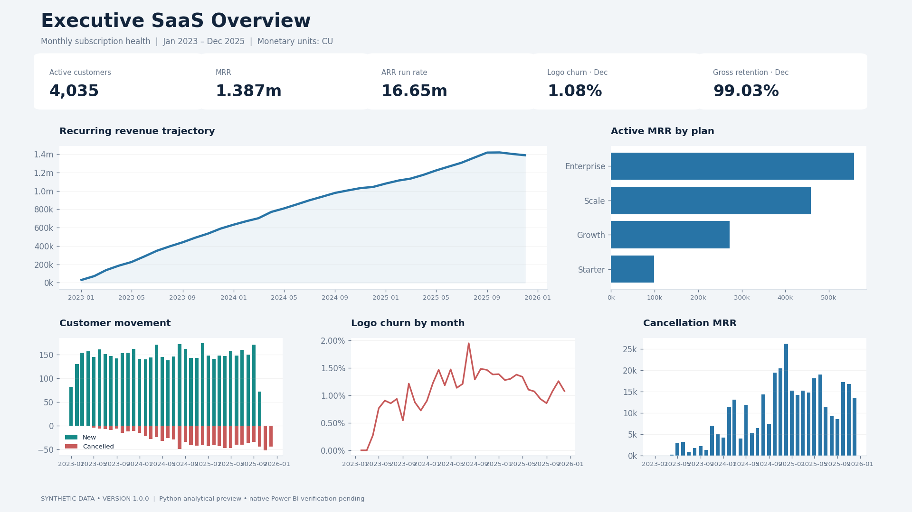
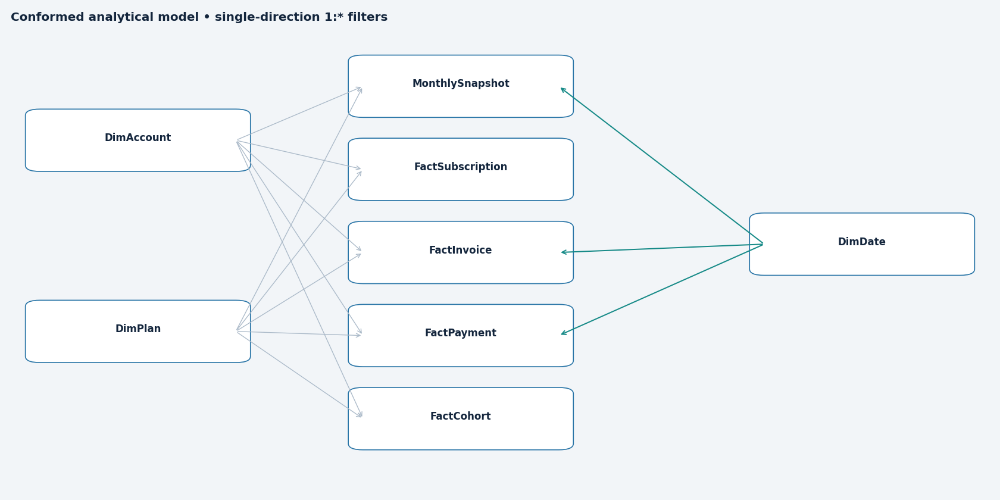

# SaaS Revenue Retention & Churn Intelligence

**End-to-end B2B SaaS analytics using SQL, Python and a Power BI project**
By Satya Ranjan Nayak · MBA, IBS Hyderabad (2026–2028)



## Business problem

Management needs to distinguish subscription growth, cancellation losses and cash collection. This project models customer exposure over time, compares acquisition cohorts and tests whether payment friction precedes churn. It turns those results into a prioritized account queue and transparent executive metrics.

## Executive summary

- **4,035 active customers · CU 1,387,441 MRR · CU 16,649,292 ARR run rate.**
- December logo churn **1.08%**, gross revenue retention **99.03%**.
- Enterprise contributes **40.2%** of active MRR.
- **CU 396,533** MRR across **1,165** priority billing-risk accounts.
- **Source limitation identified:** terminal Non-void December invoices are all open; no starts occur after October. These caveats prevent a misleading performance story.

See [eight quantified findings and five recommendations](docs/business_insights.md). All data are **synthetic educational data**, not industry benchmarks.

## Dashboard

Three report pages: Executive SaaS Overview, Customer Retention Intelligence, Billing Health & Revenue at Risk. Plan, segment, region and channel dimensions filter conformed facts; monthly snapshot facts supply time-correct MRR and beginning exposure. A cohort fact preserves account-level weighting and censoring.

**Delivery status:** editable `.pbip` / PBIR report and `model.bim` semantic model are included. Power BI Desktop is unavailable in this Linux environment: native refresh, DAX engine evaluation, slicer/cross-filter acceptance and `.pbix` export are **pending**. PNGs are Python-rendered analytical previews, not Power BI screenshots. Do not mistake static previews or JSON schema checks for native report acceptance.

[Open Power BI instructions](powerbi/README.md) · [Retention preview](assets/retention_dashboard.png) · [Billing preview](assets/billing_dashboard.png)

## Data model



DimAccount and DimPlan have single-direction 1:* relationships to snapshot, subscription, invoice, payment and cohort facts. DimDate filters monthly snapshots on month_end, invoices on invoice_date and payments on attempted_at. Cohorts use their own cohort/age axes. No invoice–payment fact relationship is used for sums, preventing retry fanout. The source chain is documented separately.

## KPI definitions

Logo churn = cancellations during month / accounts active immediately before month start. MRR = active contracted monthly value at month-end. ARR = 12 × MRR, an annualized run rate. Gross revenue retention = 1 − cancelled MRR / beginning MRR. Collection = successful payment value / non-void invoice value. [Full dictionary](docs/metric_definitions.md).

## SQL and Python

Nine modular SQL files cover customer distributions, exposure-based churn, independent raw-lifecycle MRR, billing reconciliation, cohorts, tenure, concentration and pre-churn failures. `run_analysis.py` executes every SQL file and compares SQL results against Python.

Python builds monthly marts, validates keys and payment consistency, produces weighted cohort retention and Kaplan–Meier curves with Greenwood intervals, and tests fixed-landmark billing signals. Historical invoice statuses are excluded from predictors. No optional classifier or fabricated NRR is presented.

## How to run

```bash
git clone https://github.com/satya20000/churnanalysis.git
cd churnanalysis
python -m venv .venv
# Windows: .venv\Scripts\activate | macOS/Linux: source .venv/bin/activate
pip install -r requirements.txt
python src/run_analysis.py
python src/build_powerbi.py
python src/verify_project.py
```

Open `notebooks/01_saas_churn_analysis.ipynb` for executed cells and inline figures. Hosted socket restrictions required a fresh-process IPython runner (`python src/execute_notebook.py`) instead of a Jupyter kernel; outputs come from actual cell execution. Raw CSVs are included under the source license. SQLite executes in memory to avoid host filesystem locking issues; query results are persisted as CSV.

## Repository

`data/raw` source CSVs and original license; `data/processed` reproducible marts and evidence; `sql` executed queries; `src` reusable pipeline and report generator; `notebooks` executed analysis; `powerbi` editable report/model, theme, DAX and Windows path setup; `docs` definitions/methodology/findings/QA; `assets` analytical previews and survival/cohort figures.

## Dataset, tools and limitations

Analytics Engineering, **SaaS Subscriptions & Customer Churn Dataset v1.0.0**, coverage January 2023–December 2025, **CC BY 4.0**. [Original dataset](https://www.analyticsengineering.com/datasets/saas-subscriptions). Attribution and original license are preserved in `data/raw`. Monetary amounts are **CU** because source currency is unspecified.

Tools executed: Python, pandas, NumPy, matplotlib, SQLite SQL and Git. Power BI PBIR/model/DAX authored; Desktop execution pending. No usage events, historical plan changes, reactivations or dated void/status changes are available. True NRR, expansion/contraction and causal billing effects cannot be established. Kaplan–Meier assumes independent censoring; landmark groups are observational and may be confounded. Terminal-month billing and acquisition cutoff need caution.
